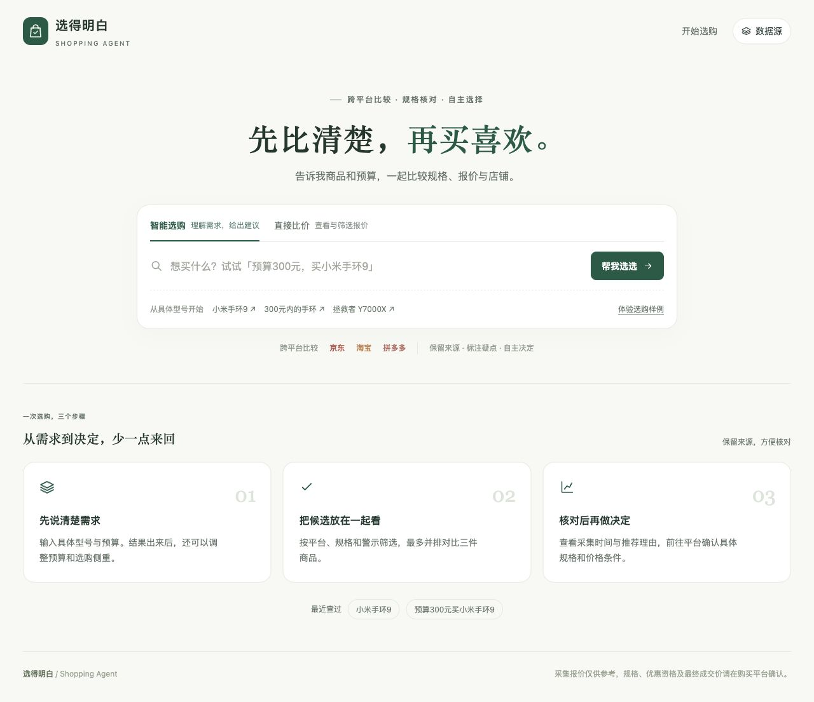
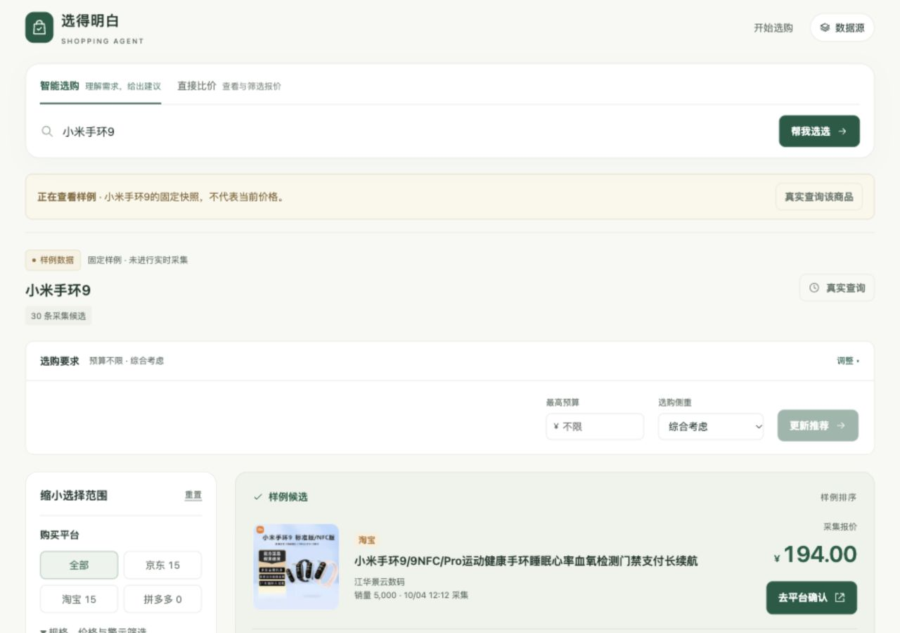
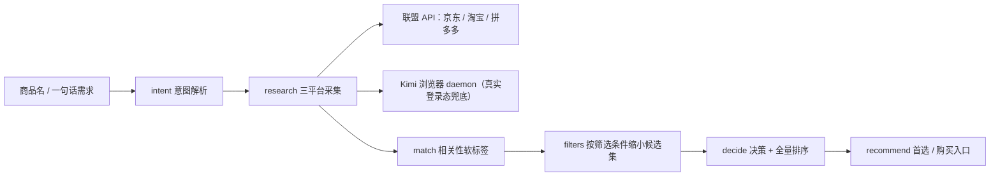

# shopping-agent

[](https://github.com/david-dev666/shopping-agent/actions/workflows/ci.yml)
[](LICENSE)
[](https://www.python.org/)

输入具体商品或购物需求，集中比较京东 / 淘宝 / 拼多多的采集报价，标注疑点、筛选候选并给出购买入口。具体 SKU、优惠资格及最终成交价由用户在平台确认。

跨平台比价 + 相关性标注（软标签）+ LangGraph agent 编排已可运行。

## 界面预览

**选得明白**：智能选购 / 直接比价，默认进行真实查询，样例需主动选择。



**结果页**：完整商品推荐卡、来源与采集时间、平台候选、筛选和最多三件商品对比。筛选改变后会提示推荐过期，点击“更新推荐”后同步首选与理由。



桌面使用侧边筛选，手机优先展示推荐并折叠筛选。执行记录保留在结果列表下方。

## 本轮改进（2026-10-16）

- 预算由代码执行；没有预算内且无警示的候选时不生成首选。
- 模型看到全部采集候选；输出经过 schema 校验，未配置/超时/连接失败可规则降级。
- 补齐手环代数、中英文别名、明确版本冲突识别，修复赠品和“未拆封”误报。
- 跨平台商品标识统一为 `platform:platform_id`；Agent 遵守人工反馈。
- 同步 Agent 在线程池运行，浏览器共用 tab 的锁跨事件循环生效。
- 规则回归样例 **36 → 120 条**；新增接口可靠性与前端逻辑测试，并纳入 CI。

新增真实节点 SSE 进度与协作停止、可编辑预算/偏好，以及显式的实时 / 缓存 / 样例来源标记。移除顶部营销标语，字号与筛选对齐统一。

后续规格证据、独立评测集、价格历史与盯价任务见 [TODO.md](TODO.md)。

## 标题规格证据（2026-10-17）

每条候选可展开品牌、代数、版本等标题证据，区分“已识别属性一致 / 信息不足 / 混卖 / 冲突”，并按状态筛选。混卖和明确冲突不产生首选，未知规格不视为一致；排序接收完整标题。该能力优先覆盖手环代数与版本，**不是实际 SKU 或成交价验证**，容量、套装等尚未核对。

边界、API 字段和后续任务见 [标题规格证据 v1](docs/07-title-evidence.md)。

## 架构



- **全量链路**：`intent → research → match → filters → decide → recommend`
- **重排链路**：前端筛选面板点「更新推荐」时走 `filters → decide → recommend`，跳过重复采集，直接在缩小后的候选集上重新决策与排序

每一步都写 trace（输入 / 输出 / 耗时），前端「执行轨迹」可完整回放；金额与阈值判断全部由确定性代码完成，LLM 只负责语义与排序。

## 原则

- 不做自动下单、自动支付、自动退款
- 不绕过登录、验证码、访问控制
- 没有授权的数据源返回空结果，不用假数据填充
- 金额与阈值判断用确定性代码完成，不由 LLM 计算

## 与其他方案的区别

- **价格追踪类**（pricebuddy 等）：价格时序扎实，但只盯用户粘贴的单个链接，不做跨平台找同款。
- **AI 导购类**：有 LLM 编排，但不沉淀长期价格数据，本质是一次性搜索问答。
- **本项目**：用采集与存储做底座，自己补一层跨平台**相关性匹配**，再套一层**可观测**的 agent 编排。

## 工作方式

```
搜索词 → 三平台采集 → 相关性标注（二手 / 竞品 / 配件 …）→ 用户筛选 → 综合排序 → 购买入口
```

采集层每个平台一个 adapter，统一输出 `RawOffer`（platform / platform_id / title / price / coupon / url / shop / sales / tags / ts）：

- **官方联盟 API 优先**：京东联盟、淘宝客、多多进宝
- **浏览器采集兜底**：通过 [Kimi 浏览器扩展](https://www.kimi.com/products/kimi-webbridge) 的本地 daemon 驱动用户已登录的浏览器，无需申请任何 API key

匹配层为品牌 / 代数 / 明确版本的确定性规则，命中即打软标签（其他型号 / 其他品牌 / 品牌不明 / 配件 / 疑似二手 / 价格异常 / 销量偏低），**不剔除任何报价**，由前端一键排除；打标项在综合排序中自动让位于未打标报价。完整 SKU 属性匹配与置信度校准仍在路线图阶段 2。

存储使用 SQLite：`offer` 表保存过滤前的全量报价，`crawl_log` 表记录每次抓取的成功 / 失败，便于排查数据缺失。

## 快速开始

```bash
cd backend
uv sync --extra dev
uv run uvicorn app.main:app --port 8000
```

打开 http://127.0.0.1:8000 即可使用。

**想先看效果？** 点击“体验选购样例”，无需 key 或扩展即可查看固定的小米手环9快照。样例有显式标注，只有主动选择后才加载；普通搜索始终请求真实数据。

`DEMO_MODE=true` 仅保留旧 API 默认行为兼容；新版前端会显式发送 `data_mode: live / sample`，不依赖全局开关。

**为什么有时返回很快？** “直接比价”的相同查询可复用 5 分钟缓存，结果会标记“缓存报价”和缓存年龄。点击“重新采集”会跳过缓存。“智能选购”目前不使用这层缓存，`/api/chat/stream` 会返回实际节点执行进度；停止任务会阻止后续节点，已发出的模型 / 平台请求可能仍需结束。

结果页可调整最高预算和选购侧重；“更新推荐”只复用已有候选重新评估，不进行新采集。输入框中的新预算会明确覆盖原始语句中的旧预算；清空表示取消预算上限。

真实数据来源二选一：

1. **浏览器采集**（默认）：安装 Kimi 浏览器扩展，在浏览器中登录京东 / 淘宝 / 拼多多
2. **官方联盟 API**：在 `backend/.env` 中填入各平台 key（参考 `backend/.env.example`），配置后优先于浏览器采集

> `docker-compose.yml` 只起一个 Postgres，用于把 `DATABASE_URL` 从 SQLite 切过去（需 `uv sync --extra postgres` 装驱动），默认无需启动。

## 安装包验证

CI 会构建 wheel，再安装到独立目录检查首页、静态资源、health、样例查询和 SSE，避免只在源码目录可运行。源码和 wheel 共用同一份前端文件。也可本地复现：

```bash
cd backend
uv build --wheel --out-dir /tmp/shopping-dist
uv pip install --no-deps --target /tmp/shopping-package /tmp/shopping-dist/*.whl
uv run python scripts/smoke_install.py --package-root /tmp/shopping-package
```

此命令使用当前环境的项目依赖，业务数据写入临时数据库，不调用平台或模型；检查结束后删除临时数据库。

## 评测与性能

- **相关性标注**：120 条人工构造开发回归集上，规则层 micro F1 **1.00**（不代表线上推荐准确率）（`cd backend && uv run python scripts/eval_rules.py`）
- **端到端**：旧版本一次 `POST /api/chat` 本机约 **15 s**（旧版本记录；新版单次验证见性能文档）（三平台采集 ≈11 s + LLM 决策 ≈3.7 s），每步耗时在 trace 中可见

口径、脚本与局限见 [docs/04-metrics.md](docs/04-metrics.md)。

## 状态与路线图

- ✅ 三平台采集（联盟 API 优先 + Kimi 浏览器 daemon 兜底）
- ✅ 相关性软标签 + 综合排序（打标项自动降级，LLM 看到标签自行降权）
- ✅ LangGraph 六节点编排 + 全流程 trace 回放
- ✅ 筛选面板：客户端即时过滤 + 「更新推荐」触发 agent 在缩小后的候选集上重新决策（`/api/refine`，跳过重复采集）
- 🚧 规格级同款匹配与置信度评估
- 📋 价格历史曲线、目标价盯价提醒

完整路线图见 [docs/03-roadmap.md](docs/03-roadmap.md)。

## 技术栈

| 层 | 选型 |
|---|---|
| 后端 | FastAPI + Pydantic |
| 编排 | LangGraph |
| 采集 | httpx（联盟 API）+ Kimi 浏览器扩展 daemon |
| 存储 | SQLite，正式版 Postgres |
| 前端 | 原生 HTML / CSS / ES modules，FastAPI 托管、无需构建 |

## 项目结构

```
shopping-agent/
├── docs/                     设计文档与截图
├── backend/
│   ├── app/
│   │   ├── api/              HTTP 接口
│   │   ├── adapters/         平台采集适配器
│   │   ├── matching/         相关性标注（软标签）+ 筛选
│   │   ├── models/           数据模型
│   │   ├── agents/           LangGraph 编排（双入口）
│   │   ├── demo/             DEMO_MODE 内置样例
│   │   └── storage/          持久化
│   ├── eval/                 规则层标注集与评测
│   ├── scripts/              评测 / 采集耗时脚本
│   ├── migrations/           alembic 迁移
│   ├── static/               前端页面与资源
│   ├── tests/
│   └── .env.example
└── docker-compose.yml
```

## 开发

```bash
cd backend
uv run pytest -q                              # 单元 / 集成 / 标签回归
uv run ruff check app tests scripts eval migrations   # lint
uv run python scripts/eval_rules.py           # 规则层评测
uv run python scripts/bench_crawl.py 小米手环9 # 采集耗时
uv run alembic upgrade head                   # 版本化建表（默认启动已自动 create_all）
```

前端测试（仓库根目录，Node.js 22+）：`node --test frontend/tests/*.test.mjs`。

接口自带 Swagger 文档：启动后访问 http://127.0.0.1:8000/docs 。

## 文档

1. [docs/00-overview.md](docs/00-overview.md) 项目定位
2. [docs/01-landscape.md](docs/01-landscape.md) 竞品调研
3. [docs/02-architecture.md](docs/02-architecture.md) 架构设计
4. [docs/03-roadmap.md](docs/03-roadmap.md) 路线图
5. [docs/architecture.html](docs/architecture.html) Agent 架构说明（可视化网页）
6. [docs/04-metrics.md](docs/04-metrics.md) 准确率与耗时
7. [docs/05-status.md](docs/05-status.md) 阶段性总结与缺口
8. [docs/06-ui-review.md](docs/06-ui-review.md) 前端验收与已知缺口
9. [docs/07-title-evidence.md](docs/07-title-evidence.md) 标题规格证据与推荐约束

## 已知限制

- 浏览器采集依赖本机的 Kimi 浏览器扩展与平台登录态，可能触发平台风控 / 验证码（触发后不绕过，提示人工完成）
- 相关性为品牌 / 代数 / 明确版本的确定性规则：跨品牌同款、规格级对齐尚未实现，误判案例见 [docs/04-metrics.md](docs/04-metrics.md)
- 目前无价格历史沉淀，比价是「当前时点」的快照

## 开源许可

本项目基于 [MIT License](LICENSE) 开源。

采集层的浏览器方案依赖 [Kimi 浏览器扩展（Kimi WebBridge）](https://www.kimi.com/products/kimi-webbridge) 的本地 daemon，感谢其开源工作。
