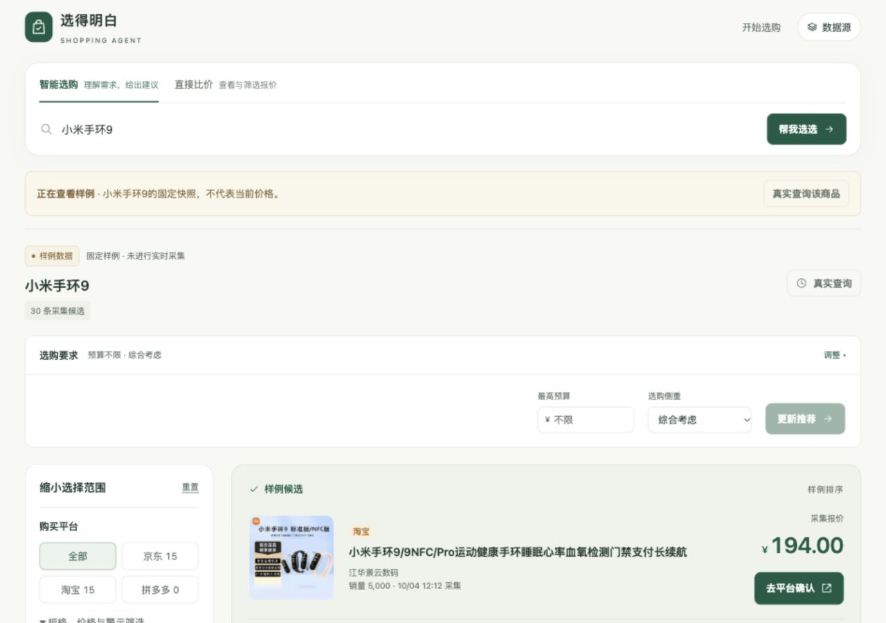

# Shopping Agent

[](https://github.com/david-dev666/shopping-agent/actions/workflows/ci.yml)
[](LICENSE)
[](backend/pyproject.toml)

**跨平台比价与购物决策 Agent。** 输入商品名或选购需求，汇总京东、淘宝、拼多多的候选报价，检查标题规格，按预算给出推荐与依据。

例如：`预算300元买小米手环9 NFC版`。



## 项目重点

- **检查规格，再比较报价**：展示品牌、代数、版本等标题依据，区分冲突、混卖和信息不足；明确冲突与混卖不作为首选。
- **可调整的选购流程**：修改预算、偏好和筛选条件，复用服务端候选快照更新推荐，无需重复采集；支持最多三件商品对比。
- **先补齐关键需求**：手环 / 手表候选存在不同代数或版本、需求未限定时，先询问再推荐；回答后复用原报价继续比较。
- **模型驱动的 Agent**：展示实际执行进度、推荐理由与节点轨迹；模型负责理解需求与推荐决策，预算和规格由代码约束；模型不可用时明确报错。

当前重点覆盖手环代数与版本。标题一致不代表实际 SKU、优惠资格或最终成交价已核实。

## 快速开始

需要 Python 3.11+ 和 uv。

```bash
git clone https://github.com/david-dev666/shopping-agent.git
cd shopping-agent/backend
uv sync --extra dev
uv run uvicorn app.main:app --port 8000
```

打开 [本地页面](http://127.0.0.1:8000)，点击 **体验选购样例** 即可预览，无需密钥或扩展。样例来自固定快照，普通搜索请求真实数据，失败不会替换成样例。

真实查询与智能排序的配置见 [backend/.env.example](backend/.env.example)：

| 能力 | 配置 |
|---|---|
| 平台采集 | 安装 Kimi 浏览器扩展并登录目标平台；或填写联盟 API 凭据，已配置的 API 优先 |
| 模型决策 | 在 `backend/.env` 配置 `LLM_API_KEY`、`LLM_BASE_URL`、`LLM_MODEL`；智能选购与综合排序需要模型；未配置或调用失败时返回不可用 |
| 存储 | 默认 SQLite，启动自动建表 |

直接比价可复用 5 分钟缓存，来源会明确标注；可点击“重新采集”跳过。Agent 查询目前不使用这层缓存。

## 如何工作

```text
需求解析 → 平台采集 → 标题核对 → 条件筛选 → 规格缺口检查
                                             ├─ 明确 → 决策排序 → 推荐与依据
                                             └─ 待确认 → 询问 → 快照续接
```

FastAPI 提供接口并托管原生 HTML / CSS / JS，LangGraph 编排流程，SQLite 保存报价、执行轨迹与候选快照。更新推荐只运行筛选后的决策流程；快照保留 24 小时，过期需重新查询。

真实采集支持进程内在途请求合并、有界排队与协作取消；共享浏览器时使用单个应用 worker。配置、取消边界与离线验收见 [采集调度说明](docs/09-collection-scheduling.md)。

## 已知限制

平台采集依赖可用数据源和登录态，可能返回空结果或要求验证；不绕过验证码，不自动下单。当前没有价格历史与盯价提醒。

已支持有限规格追问与快照续接，见 [规格澄清说明](docs/12-clarification.md)。详情页限量补查、通用任务检查点与自动恢复尚未实现；后续任务见 [TODO](TODO.md)。

## 开发与文档

- [开发指南](docs/08-development.md)：测试、安装包、数据库迁移及目录说明。
- [当前性能实测](docs/14-performance-20261101.md)：三组实时需求的五次有效完整查询，以及九次已有报价重新决策耗时。
- [当前 Agent 评测](docs/13-agent-evaluation.md)：真实模型工作流、多轮澄清与约束前后对照。
- [历史实测](docs/11-decision-evaluation.md)：早期决策约束与三平台耗时。
- [标题标签评测](docs/10-evaluation-20261031.md)：141条真实需求—标题样本及回归结果。
- [标题证据与快照](docs/07-title-evidence.md)：推荐约束、接口契约和限制。
- [AI 辅助评测](backend/eval/README.md)：20 例历史样本、逐例理由和待确认项；非独立准确率。
- [当前进展](docs/05-status.md) · [架构设计](docs/02-architecture.md) · [界面验收](docs/06-ui-review.md)。

[MIT License](LICENSE)。浏览器采集使用 [Kimi 浏览器扩展](https://www.kimi.com/products/kimi-webbridge) 的本地 daemon。
